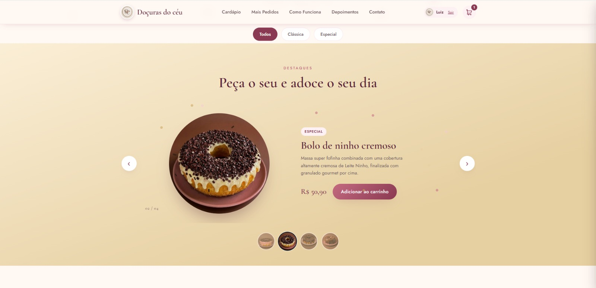

# 🍰 Doçuras do Céu

Projeto de **Desenvolvimento Web** criado para apresentar uma experiência digital de uma confeitaria, permitindo visualizar produtos, adicionar itens ao carrinho e realizar pedidos de forma prática através do WhatsApp.

## 📸 Preview



> *Adicione aqui uma captura de tela atualizada do projeto.*

## ✨ Funcionalidades

* Catálogo de produtos com diferentes categorias;
* Filtros para facilitar a navegação pelos produtos;
* Carrossel interativo de produtos;
* Sistema de carrinho de compras;
* Persistência do carrinho utilizando `localStorage`;
* Seleção de data e horário para o pedido;
* Validação de antecedência mínima para pedidos;
* Validação dos horários de funcionamento;
* Seleção da forma de pagamento;
* Opções relacionadas à entrega do pedido;
* Finalização do pedido através do WhatsApp;
* Sistema de login e cadastro de usuários;
* Área administrativa para gerenciamento;
* Interface responsiva para diferentes tamanhos de tela;
* Integração com WhatsApp e Instagram.

## 🛠️ Tecnologias

* **HTML5** — estrutura e organização do conteúdo;
* **CSS3** — layout, responsividade, animações e identidade visual;
* **JavaScript** — lógica da aplicação, interações, filtros, carrinho e validações;
* **localStorage** — persistência dos dados do carrinho no navegador;
* **Node.js / APIs** — suporte às funcionalidades do projeto;
* **Vercel Postgres** — armazenamento de dados;
* **Jose** — suporte relacionado à autenticação e tokens;
* **Git/GitHub** — versionamento e gerenciamento do projeto;
* **Vercel** — publicação da aplicação.

## 💡 O que pratiquei

Durante o desenvolvimento, pratiquei conceitos importantes de **Front-end e desenvolvimento de aplicações web**, como:

* Manipulação do DOM;
* Eventos em JavaScript;
* Manipulação de arrays e objetos;
* Filtros e categorias de produtos;
* Criação de carrinho de compras;
* Persistência de dados com `localStorage`;
* Validação de formulários;
* Validação de datas e horários;
* Manipulação de estados da interface;
* Integração de pedidos com WhatsApp;
* Criação de interfaces responsivas;
* Organização de arquivos e assets;
* Integração entre Front-end e recursos de Back-end;
* Autenticação e gerenciamento de usuários;
* Publicação de aplicações utilizando Vercel.

## 📂 Estrutura

```text
📦 Docuras_do_ceu
├── 📁 api
├── 📁 images
├── 📁 lib
├── 📄 admin.html
├── 📄 index.html
├── 📄 package.json
├── 📄 script.js
└── 📄 style.css
```

## 🎯 Objetivo

O projeto foi desenvolvido como uma experiência prática de **Desenvolvimento Web**, buscando transformar uma confeitaria em uma experiência digital completa, combinando apresentação dos produtos, interação com o usuário e facilidade para realização de pedidos.

Além de trabalhar a parte visual da aplicação, o projeto permitiu praticar conceitos de lógica, manipulação de dados, validações, armazenamento local, autenticação e integração com serviços externos.

O **Doçuras do Céu** também representa uma etapa da minha evolução no desenvolvimento Front-end, buscando aplicar os conhecimentos adquiridos em um projeto com uma proposta mais próxima de uma aplicação real.


## 🌐 Projeto

**Deploy:**
https://docuras-do-ceu.vercel.app/


## 👨‍💻 Autor

**Luiz Henrique**
Desenvolvedor Web / Front-end em formação.

> *Aprendendo, construindo, errando e melhorando um projeto de cada vez.*
